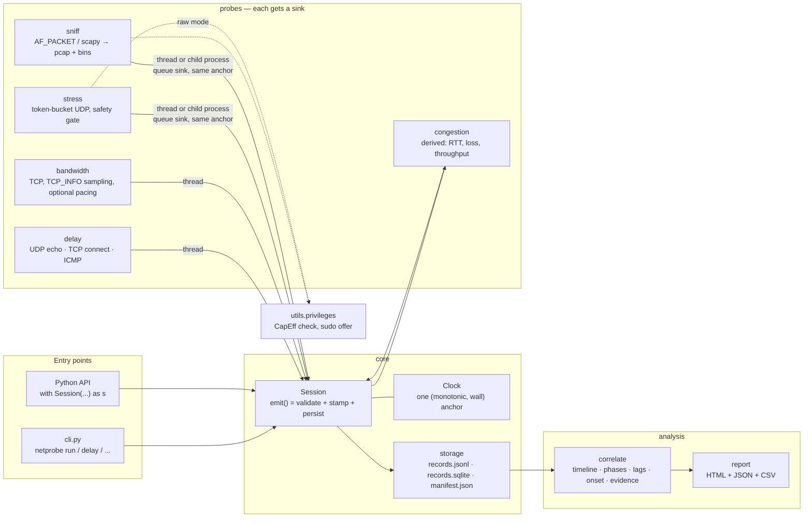

# Architecture

## Components



* **Probes never write records or files themselves.** They receive a *sink*
  (the `Session`, or `_QueueSink` in an isolated child process) and call
  `sink.emit(probe, metric, value, ts_ns=..., **meta)`.
* **Concurrency.** Background probes run as threads. CPU-heavy probes
  (load generation, capture) can run with `isolate=True` in a `spawn`ed child
  process; the child rebuilds the session clock from the serialized anchor
  (`CLOCK_MONOTONIC` is system-wide) and forwards records over a queue. This
  keeps the interpreter lock from perturbing delay timestamps. `netprobe run`
  isolates stress and sniff by default.
* **Congestion is derived, not measured**: a deterministic function of
  delay/bandwidth records, so it can be recomputed offline with different
  parameters (`netprobe report RUN --window 0.5`).

## Unified record schema

Every measurement is one `Record`:

| field          | type  | meaning |
|----------------|-------|---------|
| `ts_monotonic` | int   | ns since the session anchor, monotonic. For event metrics this is the event time (see below) |
| `ts_wall`      | float | UNIX seconds, *derived* from the anchor (`anchor.wall + ts_monotonic`), never read independently |
| `probe`        | str   | `delay`, `bandwidth`, `stress`, `sniff`, `congestion` or a registered custom probe |
| `target`       | str   | `ip:port` or interface |
| `metric`       | str   | from the schema table below |
| `value`        | float | finite |
| `unit`         | str   | fixed per (probe, metric); a mismatching unit raises `SchemaError` |
| `meta`         | dict  | JSON-serializable details (seq numbers, window length, pcap frame range, ...) |

Schema (`netprobe.core.session.METRICS`):

| probe | metric | unit | timestamp semantics |
|---|---|---|---|
| delay | `rtt` | ms | probe departure; `meta.recv_ns` = arrival |
| delay | `jitter` | ms | RFC 3550 running estimate, at departure |
| delay | `lost` | count (1) | departure of the lost probe |
| delay | `loss`, `sent` | ratio, count | end of probe (summary) |
| bandwidth | `throughput` | bps | interval end, `meta.window_ns`, `meta.basis` ∈ {acked, sent, received} |
| bandwidth | `tcp_rtt`, `cwnd`, `retrans` | ms, segments, count | interval end (Linux `TCP_INFO`) |
| bandwidth | `goodput_total` | bps | end of transfer, receiver-confirmed |
| stress | `offered_rate`, `packets` | bps, count | interval end |
| stress | `event` | marker | `meta.event` ∈ {start, stop} |
| sniff | `pkts`, `bytes`, `tcp_retrans` | count, bytes, count | bin end; `meta.frame_first/last` = pcap frame numbers |
| congestion | `level`, `index` | 0–3, 0–1 | window end |
| congestion | `onset`, `recovery` | marker (value = s) | the onset/recovery time |

Custom probes extend the schema with `register_metric(probe, metric, unit)`.

## Clock

`Clock` takes the tightest of 7 `(mono, wall, mono)` bracket readings as the
anchor and records half the bracket as `uncertainty_ns`. All probes read
`clock.now_ns()`; kernel packet timestamps (wall clock, `SO_TIMESTAMPNS`) are
mapped with `clock.wall_ns_to_rel()`. At session close the manifest records
`drift_ns_at_close`: how far the wall clock moved relative to monotonic
during the run (NTP slew/steps), which bounds the error of wall-stamped
inputs.

## Run directory

```
runs/<run_id>/
  manifest.json   schema version, tool version, clock anchor + drift, host,
                  privileges, every probe invocation with parameters
  records.jsonl   unified records
  records.sqlite  (optional)
  capture.pcap    (sniff) nanosecond pcap, opens in tcpdump/Wireshark
  report.html     self-contained correlation report
  report.json     machine-readable correlation result
  timeline.csv    aligned timeline (one row per bin)
```

## Correlation pipeline

1. **Align**: bin all time-series metrics by `ts_monotonic` (default 0.5 s);
   aggregation per metric is fixed (`AGGREGATION` in `src/netprobe/analysis/correlate.py`).
2. **Phases**: split the run at `stress.event` start/stop markers
   (baseline / load / after); without load, split at the detected onset.
3. **Congestion**: windowed signals (queuing delay, loss, throughput drop)
   against a baseline → level, onset, decision time, recovery
   (see `src/netprobe/probes/congestion.py` docstring for the exact rule).
4. **Lag**: lagged Pearson correlation between offered load and RTT /
   throughput.
5. **Evidence**: pcap frame range and on-wire retransmissions in the onset
   window, so the claim "congestion started at t" points to packets.
